# Rijdwerk Occasions

A website for a used car dealer with a public car catalog and an admin panel. Built with plain PHP and MySQL, with no framework. It is a portfolio project for **Rijdwerk Occasions**, a fictional dealer in the fictional town of Bremdonk (Noord-Brabant).

> **Demo notice:** the business, people, cars, license plates and photos are fictional. The car photos are studio renders that a script in this repo generates. No real dealer photos or listings are used.

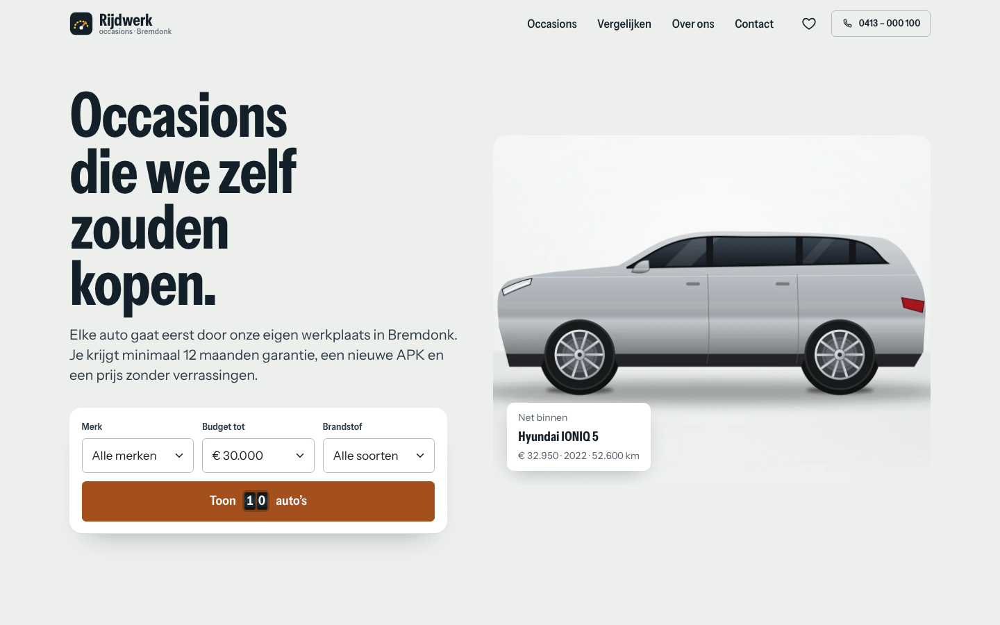

## What it does

Visitors can browse and filter the stock, view each car in detail, work out a monthly payment, compare cars side by side and request a test drive. The dealer manages cars, photos and requests in an admin panel. When adding a car, the admin can fill in most fields automatically by looking up the Dutch license plate in RDW Open Data.

## Features

### Public site
- **Homepage**: a quick finder whose odometer counts the matching cars live as you change filters. Also shows the newest cars, "continue where you left off" (recently viewed), how buying works, and opening hours.
- **Catalog** (`/occasions`):
  - Filters: search, brand → model (dependent dropdown), price range, year range, max mileage, fuel, transmission and body type.
  - Sorting: newest, price, year and mileage.
  - Pagination.
  - Filters live in the URL (`/occasions?merk=kia&brandstof=elektrisch`), so a search can be shared or bookmarked.
  - Live updates without a page reload: only the results are swapped, with `history` support for the back button. Without JavaScript it works as a normal GET form.
  - On mobile the filters open as a bottom sheet with a "Show N results" button.
- **Car detail** (`/occasions/{slug}`):
  - Photo gallery with swipe on mobile (scroll-snap), thumbnails, keyboard navigation and a fullscreen viewer.
  - Specs table, equipment grouped by category, and an available / reserved / sold status.
  - The photo morphs from the catalog card into the gallery using cross-document View Transitions.
  - A sticky call-to-action bar on mobile.
- **Finance calculator**: down payment slider and loan term. The monthly payment animates as you change the inputs. It is clearly marked as an indication, with the APR and the Dutch "Let op! Geld lenen kost geld" warning.
- **Test drive and question forms**:
  - The date picker only offers time slots that are valid for the chosen weekday (Saturday hours differ; closed on Sunday).
  - After submitting you get a thank-you page with a reference number (`RW-2026-0009`).
  - Two emails are sent: a confirmation to the customer and a notification to the dealer.
- **Favorites, compare (max. 3) and recently viewed**: stored in `localStorage`, no account needed. The comparison URL (`/vergelijken?ids=11,3,10`) can be shared, and the best value per row is highlighted.
- **SEO**:
  - Clean URLs, canonical tags and Open Graph tags.
  - schema.org `Car` + `Offer` + `BreadcrumbList` and `AutoDealer` with opening hours.
  - Dynamic `sitemap.xml` and `robots.txt`.
- Pages: about us, contact (with a self-drawn SVG map, so no third-party map), privacy statement (AVG/GDPR) and a 404 page.

### Admin (`/admin`)
- **Dashboard**:
  - Cars per status and new requests.
  - Requests over the last 14 days (bar chart).
  - Upcoming test drives.
  - Most viewed cars (unique views, bots ignored).
- **Cars**:
  - List with status tabs, search by brand, model or plate, and a quick status change (AJAX).
  - Full form with all fields, equipment checkboxes, featured and visibility toggles, and a warning when you leave with unsaved changes.
- **License plate lookup**:
  - Type a plate (for example `K-482-TB`) and click "Gegevens ophalen" ("fetch details"). Brand, model, year, first registration, APK date, color, body type, fuel, power, engine size, doors and seats are filled in automatically.
  - The fields that were filled in are highlighted.
  - Clear messages for an invalid plate, an unknown plate, a vehicle that is not a passenger car, and the RDW being down or slow.
- **Photos**:
  - Drag-and-drop upload with a progress bar.
  - Drag to reorder (with keyboard-friendly buttons as well). The first photo is the main photo.
  - Delete through a confirmation dialog.
- **Requests**:
  - Filter by type and status, and search.
  - Detail page with the status workflow (new → contacted → scheduled → completed / cancelled), a status history, internal notes, and a GDPR delete that requires typing the reference number.

## Tech

| Part | Choice |
|---|---|
| Backend | PHP 8.2+, own small router, PDO (MySQL/MariaDB) |
| Frontend | HTML, CSS (custom properties, grid), vanilla JavaScript |
| Font | Instrument Sans (variable, self-hosted, width axis used for headings) |
| Mail | PHPMailer, `MAIL_DRIVER=log` writes `.eml` files to `storage/mail/` |
| Build | `npm run build` (esbuild) creates `.min.css` / `.min.js`, served automatically when `APP_ENV` is not `local` |
| Demo photos | `npm run demo` (`scripts/build-demo.mjs`) draws SVG renders per body type and color, converted to WebP with sharp |

### Structure
```
public/            the only folder reachable from the web (index.php, assets, uploads)
src/               PHP classes (App\…) and controllers (Site, Admin)
templates/         views: layout, pages, partials, admin, emails
database/          schema.sql, seed.sql, demo.sql
storage/           logs, mail (.eml), cache (not web-reachable)
scripts/           build, demo data + renders, create-admin
tests/fixtures/    fake RDW responses (also a malicious one) for RDW_DRIVER=fake
docs/screenshots/
```

## Security

| Threat | Measure |
|---|---|
| SQL injection | Prepared statements everywhere (`PDO::ATTR_EMULATE_PREPARES = false`). Sort keys go through a **whitelist** that maps `?sorteer=prijs-oplopend` to a fixed `ORDER BY` clause, so user input never ends up in `ORDER BY`. Filter values (fuel, body, brand) are checked against allowed values or the database. Numeric ranges are validated with min/max and swapped if reversed. |
| XSS | All output is escaped with `e()` (`htmlspecialchars`, `ENT_QUOTES`). JSON in pages uses `JSON_HEX_TAG`. A strict **Content-Security-Policy** (`script-src 'self'`, no inline scripts or styles) acts as a second line of defense. |
| CSRF | A token on every POST form and AJAX request (`X-CSRF-Token` header), checked with `hash_equals`. A failure returns **403** (not 419, which Apache does not know). Logout is POST-only. |
| Spam / abuse | Honeypot field, a signed **time trap** (an HMAC-signed timestamp; faster than 3 s counts as a bot and gets a fake success page), and **rate limits**: 5 requests/hour and 30 attempts/hour per IP. IPs are only stored as an HMAC hash with `APP_KEY` and are deleted after 24 hours. |
| Login | `password_hash` bcrypt cost 12. A dummy hash for unknown e-mails keeps the response time the same (no user enumeration through timing). Rate limits per IP and per e-mail (5 attempts per 15 min). `session_regenerate_id`, idle (30 min) and absolute (8 h) timeouts, user-agent binding, and `HttpOnly` + `SameSite=Lax` cookies. |
| File upload | Checked with `finfo` + `getimagesize` (not the extension), 8 MB per file, 40 MB per batch, max 20 photos per car, min 400 px, max 40 MP (blocks decompression bombs). EXIF orientation is applied, then the image is cropped to 4:3 and **re-encoded to WebP** with GD, which strips GPS/EXIF and polyglot payloads. Files get random names. The upload folder has `SetHandler none`, PHP off, and only `^[a-f0-9]{32}(-\d+)?\.webp$` is allowed, with `nosniff` and a sandbox CSP. |
| RDW API | The call is made **server-side** (the browser never talks to the RDW), HTTPS only, no redirects, 3 s connect / 6 s total timeout, max response size, and rate limited per admin. The plate is first validated against all 14 Dutch sidecodes. The **response is treated as untrusted input**: only known fields are read, each is type-checked, stripped of unexpected characters, length-limited and range-checked, then escaped again on output. Results are cached for 24 hours. |
| Secrets | `.env` is outside the web root and in `.gitignore`. `.env.example` has no secrets. |
| Headers | CSP, `X-Frame-Options: DENY`, `nosniff`, `Referrer-Policy`, `Permissions-Policy`, and HSTS over HTTPS. |
| Privacy | No tracking or analytics cookies, no third-party fonts or maps. Favorites stay in the browser. Admins can delete a request including its notes and history (GDPR). |

### What was tested
- **Uploads**: PHP renamed to `.jpg`, SVG with script renamed to `.png`, JPEG+PHP polyglot (the payload is gone after re-encoding), a photo with GPS EXIF (metadata stripped), a 20,000 × 20,000 PNG bomb, and direct requests to `.php` / `.html` files in the upload folder (403).
- **Injection**: SQL in `sorteer`, `merk`, `ids` and `pagina`, XSS in search and every form field (shown as text, also in e-mails and in the admin).
- **CSRF**: missing token → 403. Not logged in → 401 (AJAX) or a redirect.
- **Bots and rate limits**: honeypot, time trap, and the 6th request within an hour is blocked. Login is blocked after 5 failed attempts. A login for an unknown user takes as long as one for a known user.
- **RDW**: invalid plate, unknown plate, motorcycle, timeout or outage, a non-JSON response, and a response with HTML/script, out-of-range numbers and nested objects.
- **Accessibility**: an axe-core audit (WCAG 2.1 A/AA + best practices) of all public and admin pages on desktop and mobile shows **0 violations**.

## Screenshots

| | |
|---|---|
| 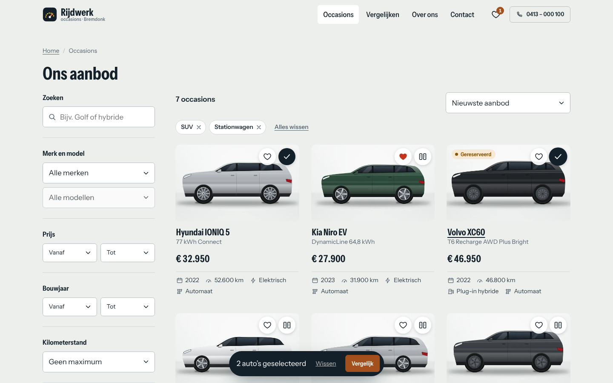 | 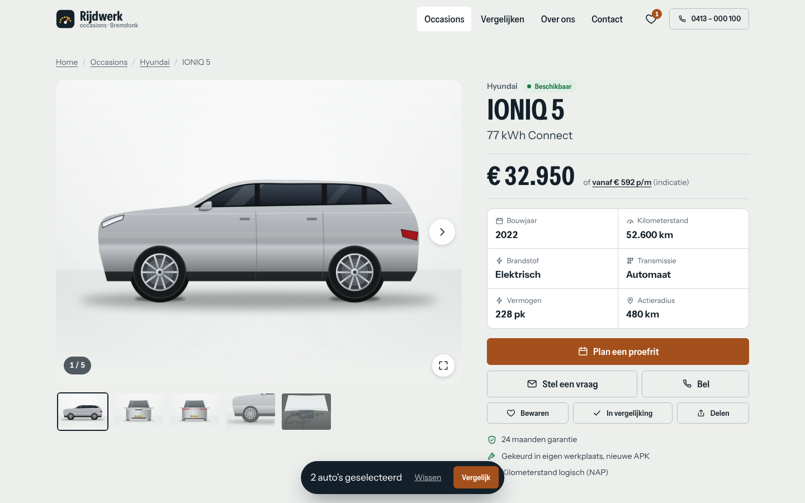 |
| 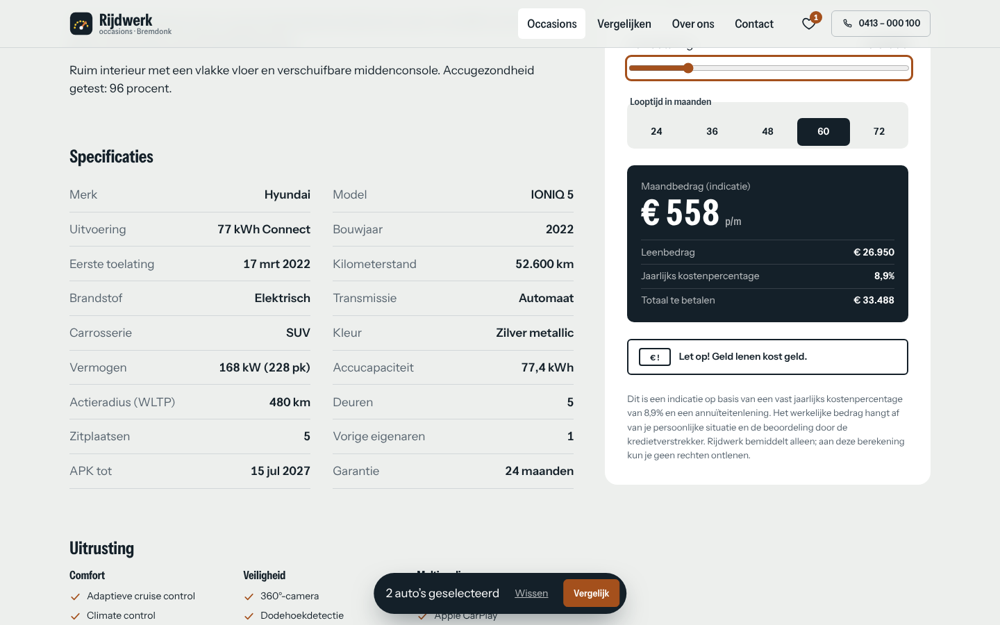 | 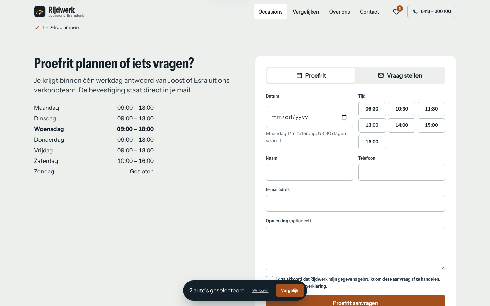 |
| 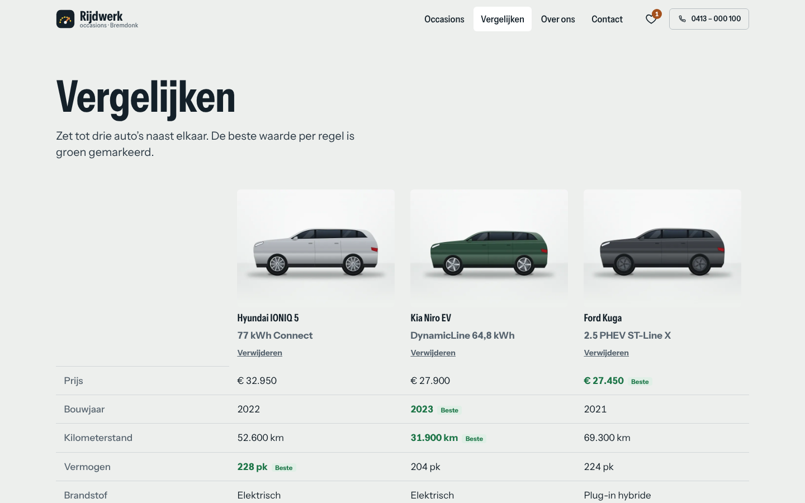 | 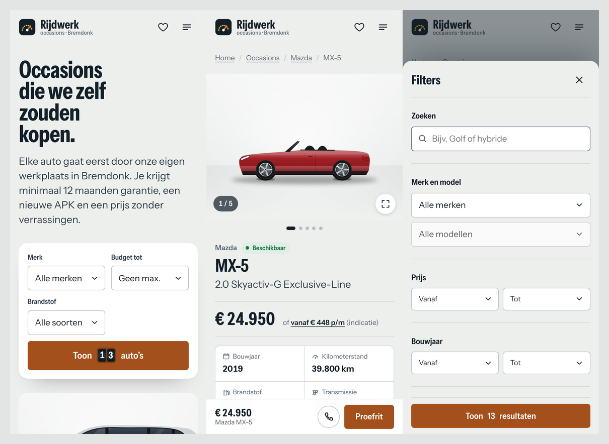 |
| 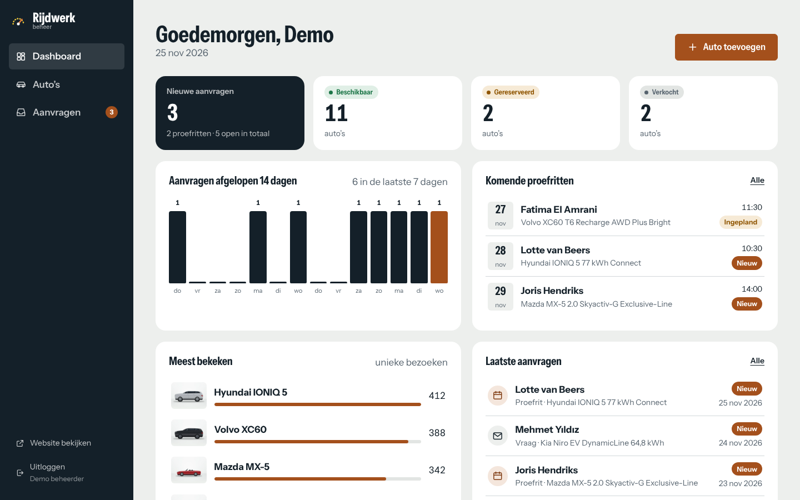 | 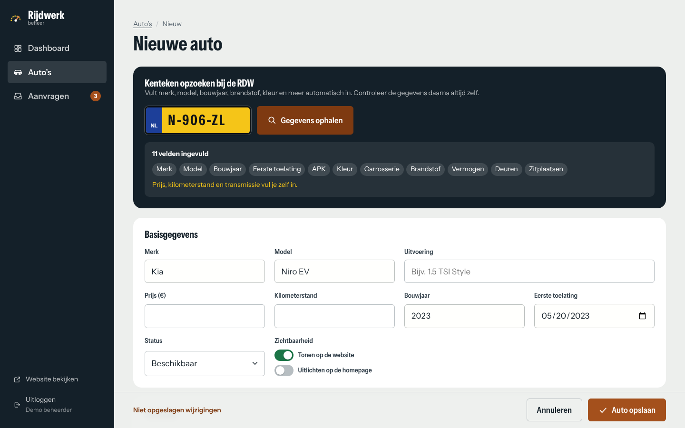 |
| 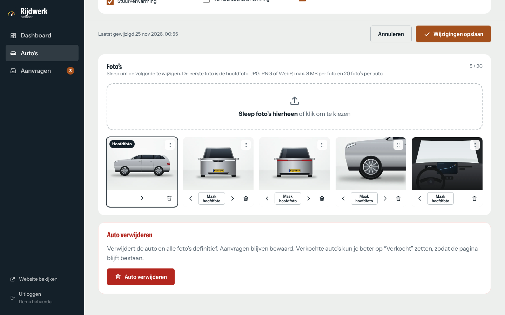 | 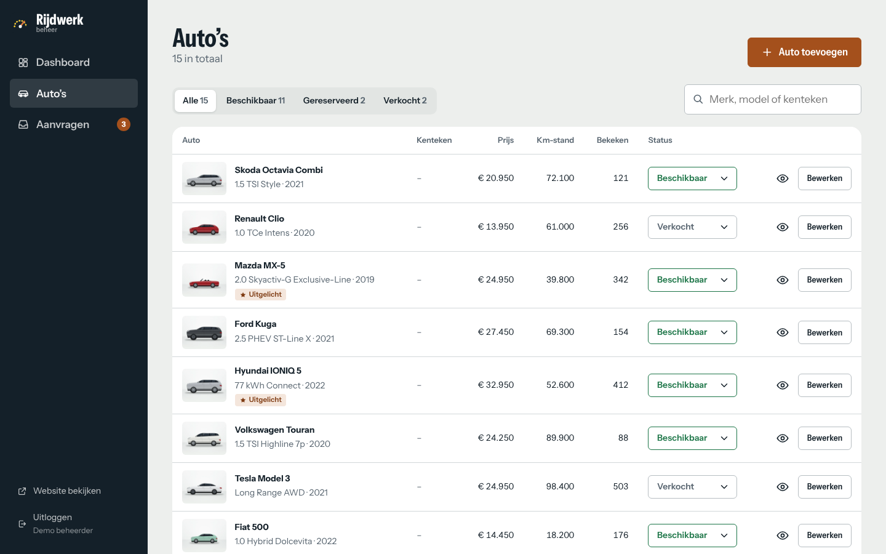 |
| 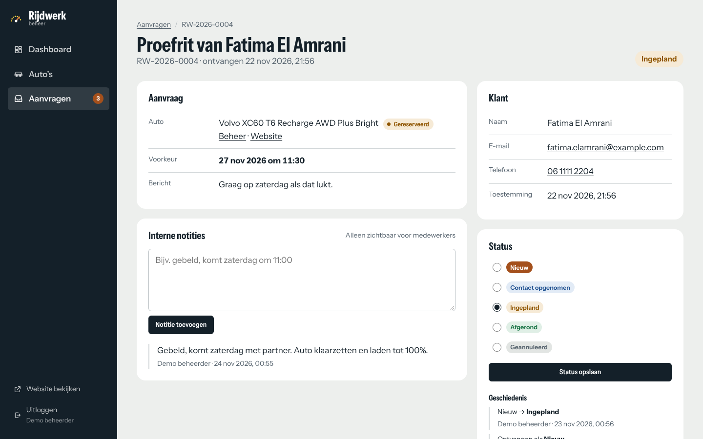 | |

## How to run (XAMPP on Windows)

1. Put the project in `C:\xampp\htdocs\autobedrijf` and start **Apache** and **MySQL** in XAMPP. `mod_rewrite` must be on; it is on by default in XAMPP.
2. Copy `.env.example` to `.env` and set `APP_KEY` to a random string of 64 hex characters, for example from `php -r "echo bin2hex(random_bytes(32));"`.
3. Import the database:
   ```
   C:\xampp\mysql\bin\mysql.exe -u root < database\schema.sql
   C:\xampp\mysql\bin\mysql.exe -u root < database\seed.sql
   C:\xampp\mysql\bin\mysql.exe -u root < database\demo.sql
   ```
4. If `vendor/` is missing, run `composer install`.
5. Open http://localhost/autobedrijf. The admin is at http://localhost/autobedrijf/admin.
   - Demo login: `demo@rijdwerk.test` / `RijdwerkDemo2026!`
   - Create your own admin with `php scripts/create-admin.php`.
6. Optional:
   - `npm install` and `npm run build` for the minified assets.
   - `npm run demo` to regenerate the demo renders and `demo.sql`.

**RDW lookup:** `RDW_DRIVER=live` calls the real RDW Open Data API. `RDW_DRIVER=fake` uses the files in `tests/fixtures/` instead. Try `K-482-TB`, `N-906-ZL`, `HX-12-XS` (malicious response), `MZ-12-LB` (motorcycle) and `XX-999-X` (outage). With the live driver these plates may belong to real cars, which is why the demo cars have no plate. An optional free app token from opendata.rdw.nl goes in `RDW_APP_TOKEN`.

**Mail:** with `MAIL_DRIVER=log`, every e-mail is saved as an `.eml` file in `storage/mail/`. You can open these in Outlook or Thunderbird.

## How to deploy

For a free demo link, **InfinityFree** works well:

1. Create an account and a subdomain, then upload everything except `node_modules/` and `.git/`. Point the document root to `public/`, or keep the root `.htaccess`, which forwards everything to `public/`.
2. Create a database in the control panel. Remove the `CREATE DATABASE` and `USE` lines from the three `.sql` files, then import them with phpMyAdmin.
3. Create `.env` with:
   - `APP_ENV=production`, `APP_DEBUG=false` and the right `APP_URL` (with `https://`).
   - A new `APP_KEY`.
   - The database credentials.
4. Run `npm run build` locally first, so the `.min` files exist.
5. Mail: `mail()` is blocked on InfinityFree. Keep `MAIL_DRIVER=log` for a demo, or use `MAIL_DRIVER=smtp` with an SMTP service (Brevo or Mailtrap, for example).
6. Check:
   - HTTPS is active (HSTS is sent automatically).
   - `/.env`, `/src` and `/database` return 403 or 404.
   - The demo login has been replaced.

For a paid client site, a Dutch shared host with PHP 8.2+ and SSH (for example Vimexx or Hostnet) is a better fit. Point the document root at `public/`.

## License

Portfolio project. The code may be viewed. The fictional brand and demo content may not be reused as a real business.
